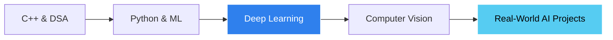

<!-- Ammar Jahangir - GitHub Profile README -->

<div align="center">


<br/><br/>


</div>

<br/>

<div align="center">
  <table>
    <tr>
      <td width="25%" align="center">
        
        <br/><b>🎓 BSCS Student</b><br/>
        <sub>Computer Science</sub>
      </td>
      <td width="25%" align="center">
        
        <br/><b>🤖 AI / ML</b><br/>
        <sub>Machine Learning</sub>
      </td>
      <td width="25%" align="center">
        
        <br/><b>🧠 Deep Learning</b><br/>
        <sub>Neural Networks & CV</sub>
      </td>
      <td width="25%" align="center">
        
        <br/><b>💻 Developer</b><br/>
        <sub>C++ | Full-Stack</sub>
      </td>
    </tr>
  </table>
</div>

<br/>

---

## 🚀 About Me

<div align="center">
  <p>
    I'm a Computer Science student passionate about building real-world applications,
    from low-level systems programming to modern AI solutions.<br/>
    I love solving problems, learning new technologies, and turning ideas into working systems.
  </p>
</div>

```python
class AmmarJahangir:
    def __init__(self):
        self.role      = "BSCS Student"
        self.focus     = ["Machine Learning", "Deep Learning", "Computer Vision"]
        self.languages = ["C++", "Python", "JavaScript", "C#"]
        self.building  = "Real-world projects that solve real problems"

    def motto(self):
        return "Learn. Build. Improve. Repeat. 🔁"
```

<br/>

## 🧠 Deep Learning Focus

<div align="center">


<br/><br/>


</div>

<br/>

<div align="center">
  <table>
    <tr>
      <td align="center" width="33%">
        <br/>
        <b>Neural Networks</b><br/>
        <sub>CNNs, training & evaluation</sub>
      </td>
      <td align="center" width="33%">
        <br/>
        <b>Computer Vision</b><br/>
        <sub>Image classification</sub>
      </td>
      <td align="center" width="33%">
        <br/>
        <b>Machine Learning</b><br/>
        <sub>Regression & classification</sub>
      </td>
    </tr>
  </table>
</div>

<br/>

## 🎯 Current Focus

<div align="center">
  <table>
    <tr>
      <td align="center" width="20%">
        <br/>
        <b>C++</b><br/>
        <sub>OOP & System Design</sub>
      </td>
      <td align="center" width="20%">
        <br/>
        <b>Python</b><br/>
        <sub>ML, DL & Data Science</sub>
      </td>
      <td align="center" width="20%">
        <br/>
        <b>Deep Learning</b><br/>
        <sub>TensorFlow / Keras</sub>
      </td>
      <td align="center" width="20%">
        <br/>
        <b>React</b><br/>
        <sub>Frontend Apps</sub>
      </td>
      <td align="center" width="20%">
        <br/>
        <b>Node.js</b><br/>
        <sub>Backend APIs</sub>
      </td>
    </tr>
  </table>
</div>

<br/>

## 🛠️ Tech Stack

<div align="center">

### 💬 Languages


### 🌐 Web & Databases


### 🧠 AI / Data


### 🧰 Tools


</div>

<br/>

## 📊 GitHub Stats

<div align="center">
  
  
</div>

<br/>

<div align="center">
  
</div>

<br/>

## 📂 Projects

<div align="center">

| Project | Description | Tech |
|---------|-------------|------|
| 🐾 **Animal Image Classification (DL)** | Deep learning model trained on 10 animal classes | `Python` `TensorFlow` `Keras` |
| 🌐 **AI-Based Hospital Management System** | Full-stack web app with AI integration for smart features | `React` `Node.js` `Express` `SQL` `AI API` |
| 📊 **Numerical ML Projects** | House price prediction, regression models, and flower classification | `Python` `scikit-learn` |
| 🧑‍🎓 **Student Management System** | Full student records, grades & data management system | `C++` |
| 🧾 **CRUD Application** | Basic CRUD operations system | `HTML` `CSS` `PHP` `MySQL` |
| ⚙️ **Assembly Language Projects** | Searching techniques implementation + Cache simulator | `Assembly` |
| 🖥️ **Operating System Project** | Process scheduling simulator (FCFS, SJF, RR, etc.) | `Python` `OS Concepts` |

</div>

<br/>

## 🗺️ Learning Roadmap

<div align="center">



</div>

<br/>

## 🔗 Connect With Me

<div align="center">

<a href="https://github.com/ammarcs23"></a>
<a href="https://linkedin.com/in/ammar-cs"></a>
<a href="mailto:ammarmalik5535@gmail.com"></a>

<br/><br/>


⭐️ From <a href="https://github.com/ammarcs23">Ammar Jahangir</a>

</div>
